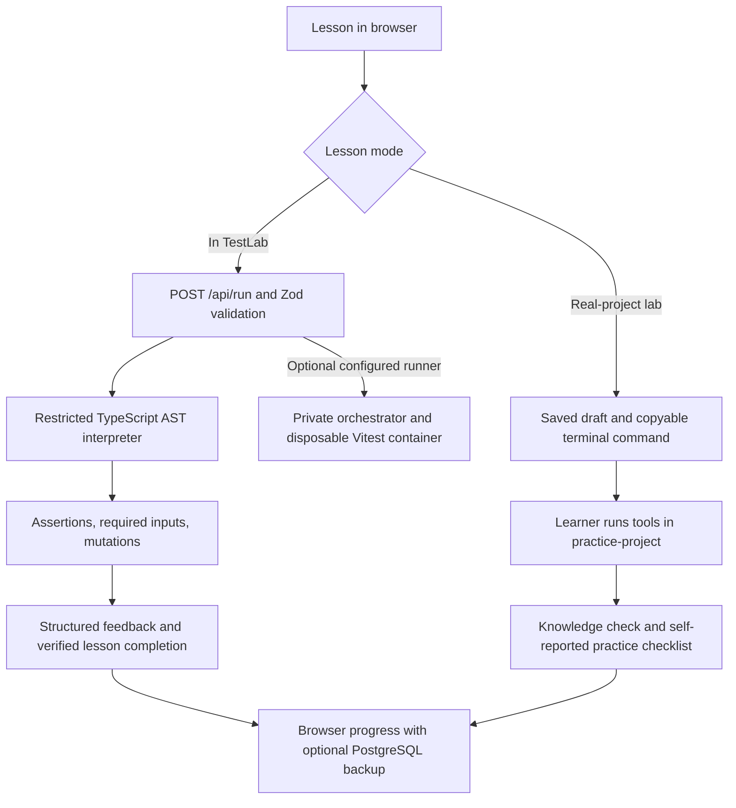

# Architecture

## Two execution experiences



The local interpreter never evaluates arbitrary JavaScript. It interprets allowlisted syntax and calls only known lesson subjects. The supported subset is deliberately smaller than Vitest. Repository labs do not call this API: promises, React, real HTTP, browser automation, and the other advanced examples run in the learner’s actual project with actual tools.

## Source layout

```text
src/app/                        Next.js pages, metadata, and API handlers
src/components/test-lab.tsx      Workspace navigation, saved state, shared dialogs
src/components/features/        Dashboard, curriculum, concepts, glossary, lab UIs
src/components/ui/              Shared controls, Radix dialog, Monaco wrapper
src/lib/content.ts              Public course catalog and original stable content
src/lib/curriculum/types.ts      Course contracts
src/lib/curriculum/interactive-lessons.ts
src/lib/curriculum/repository-lessons.ts
src/lib/curriculum/practice-project.ts  Canonical TaskBoard starter files
src/lib/curriculum/concepts.ts   Added concept lessons and glossary
src/lib/curriculum/stages.ts     Ordered personal learning stages
src/lib/testing/                Interpreter, subjects, objective checks, regression tests
src/lib/project-guides.ts       JS/TS file-level setup examples for browser lessons
src/lib/progress.ts             Versioned progress schema
src/lib/database.ts             Optional Prisma adapter
src/styles/                    Workspace, learning, course, and responsive styles
practice-project/              Independent runnable TaskBoard learning project
runner/                        Optional private Docker orchestration
prisma/                        Optional PostgreSQL schema
scripts/                       Asset setup, starter generation, example verification
tests/e2e/                     TestLab browser-flow checks
docs/                          This documentation
```

## Persistence and identity

Browser storage holds the profile name, completion IDs, activity, estimated rounded session minutes, and code drafts. Existing completion IDs remain valid when the curriculum grows; percentages use the current total. Adding content therefore increases the denominator without deleting progress.

Optional PostgreSQL storage uses Prisma and an anonymous HttpOnly session cookie. It is not an account system, not cross-device login, and not proof that repository tests ran. Do not use these completion flags as a credential or public assessment score.

Concept IDs currently use stable append-only indices (`concept-0`, etc.). Do not reorder existing concepts without a progress migration. Practical lessons use stable slugs.

## Project boundaries

TaskBoard has its own package.json, lockfile, Vitest config, Playwright config, and port 3100. Its dependencies and generated outputs are ignored by root Git rules. Root TypeScript and ESLint checks exclude the independent project so a learner’s intentionally failing exercise does not break TestLab’s build.

TaskBoard is intentionally local: in-memory data, a fixed teaching token, and a development reset endpoint. It demonstrates test boundaries; it is not infrastructure to expose as a public application.

The React component labs exercise `TaskForm.jsx` as a standalone component. The lightweight HTTP demo serves its own HTML form from `public/index.html`. They illustrate the same feature at different scopes, but the browser tests do not mount that React component. When transferring these patterns to your app, test your actual assembled frontend as well.

## Assets and infrastructure

Geist fonts and the Monaco bundle are self-hosted. The editor build replaces Monaco’s vendored sanitizer with the patched dependency as well as overriding the package-level dependency. Generated assets are ignored and reproduced during setup/build.

The optional Docker runner limits network, memory, CPU, processes, capabilities, execution time, and output. A live Docker host and a live PostgreSQL database were not supplied for verification. See the root README for their separate setup and limitations.
